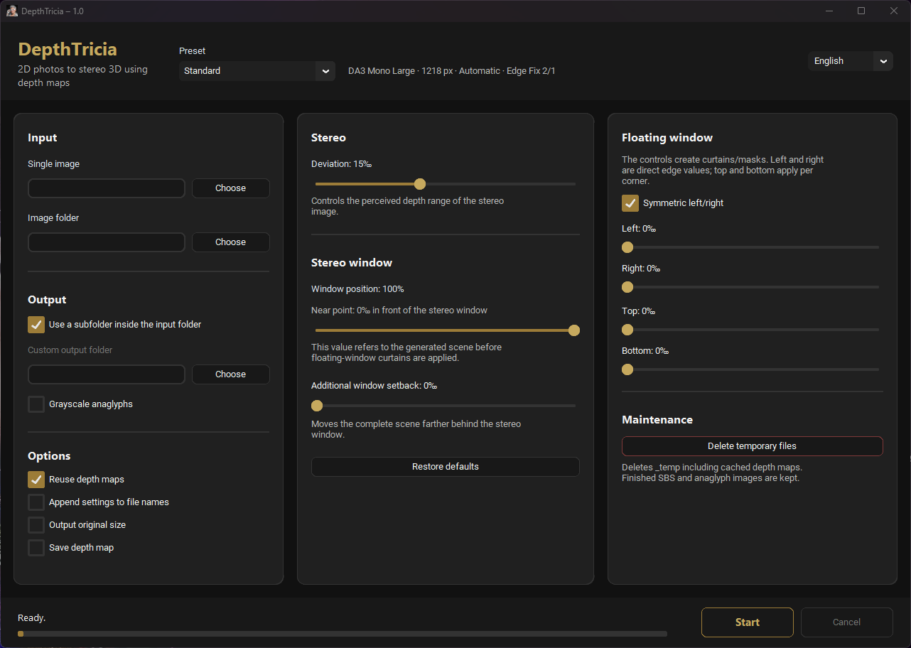

# DepthTricia 1.0

[Deutsch](README_DE.md)

DepthTricia is a local Windows tool for converting individual 2D photographs or image folders into stereo 3D. Each photograph produces a parallel side-by-side stereo image (SBS) and either a colour or grayscale anaglyph.

Depth estimation uses **Depth Anything V2 Small**, **Depth Anything 3 Mono Large** or **Depth Pro**. The interface, stereo controls and metadata handling follow SplatTricia. The interface is available in German and English.

Processing runs locally, without an account, cloud or tracking. Missing runtime packages or models are installed or downloaded only after confirmation. Once installed, they work offline.

[Download DepthTricia 1.0](https://github.com/muelli1975/DepthTricia/releases/tag/v1.0)

## Requirements and installation

- 64-bit Windows.
- CPU processing is supported; a compatible NVIDIA graphics card with a current driver enables CUDA acceleration.
- No separate Python installation or CUDA toolkit is required for the portable package.

Download and extract `DepthTricia_1.0.zip`, then start `DepthTricia.exe`. DA2 and DA3 are included in the main ZIP. On first processing, the program asks before installing or downloading missing packages.

For offline installation, download **all ZIP files from the same release** into one folder. Extract only `DepthTricia_1.0.zip`; leave the other ZIPs beside the extracted `DepthTricia` folder. They contain the matching CUDA 12.8 runtime packages and the original Apple Depth Pro checkpoint. Local packages are used first. Archives and installed files are checksum-verified; each ZIP is below 2 GiB. When updating 1.0, replace the application and obtain all matching runtime packages from the updated release; retain your `settings.json`.

Models are stored visibly in `models`. Existing models are loaded without network checks, accounts, tokens or a Hugging Face cache dependency.

## Basic use

1. Select a single image or an image folder.
2. Use **Use a subfolder inside the input folder** or choose a custom output folder.
3. Select a preset. For CPU processing, choose **CPU**.
4. Adjust deviation and stereo-window position as needed.
5. Optionally select grayscale anaglyphs, **Output original size** or **Save depth map as PNG**.
6. Click **Start**.

The selected model, resolution, device and edge settings remain visible beside the preset list. **Cancel** requests cancellation; the current processing step may need to finish first.

## Models and presets

Presets select the depth model, processing device, resolution and edge fix together.

| Preset | Model | Depth resolution | Processing |
| --- | --- | --- | --- |
| Standard | DA3 Mono Large | 1218 | Automatic |
| CPU | DA2 Small | Model default: 518 | CPU |
| Quick | DA2 Small | Model default: 518 | Automatic |
| Fine | DA3 Mono Large | 2048 | Automatic |
| Depth Pro | Depth Pro | Native: 1536 × 1536 internally | Automatic |

All built-in presets use edge fix **2 horizontal / 1 vertical**. **Automatic** selects CUDA when available, otherwise CPU. Custom presets save model, device, resolution and edge fix together. Depth Anything accepts custom resolutions from 196 to 4096 and internally rounds up to its 14-pixel grid; 2048 becomes 2058. Depth Pro's internal resolution stays fixed.

Depth Pro uses iw3's preprocessing and native inverse-depth map, without first enlarging that map to the working image size. Output photos retain their selected size; small-source depth maps follow iw3's size handling. Previous Depth Pro caches are recalculated automatically. The original Apple model and weights are unchanged, as are model precision settings. **Fine** remains experimental: very high depth resolutions or deviation can produce incorrect learned hole masks. No resolution, deviation or device is reduced automatically.

DA3 at high resolution, Depth Pro and original-size inpainting need more time and memory. Settings and the selected device are never reduced automatically after a memory error.

## Stereo controls

**Deviation** controls the horizontal depth range; the default is **15‰**. **Stereo-window position** distributes that depth relative to the picture plane; the default is **100%**.

The additional setback moves the entire scene behind the stereo window. Any gaps created at the image borders are filled automatically. It is available only at a window position of 100%.

**Floating-window curtains** mask edge areas. Near-point display and slider behaviour follow SplatTricia: ranges, steps, symmetry and mutual exclusions are retained. The near-point display describes the scene from deviation and stereo-window position, before the additional setback and curtains.

Automatic 2D-to-3D conversion remains an estimate. Check depth, window placement and image edges visually, especially for projection.

## Output and reusable depth maps

The selected output location contains:

| Folder | Contents |
| --- | --- |
| `sbs` | Parallel side-by-side JPEG images |
| `anaglyph` | Colour or grayscale anaglyph JPEG images |
| `_temp` | Reusable depth maps and cache data |
| `depth_maps` | Optional 16-bit relative depth PNGs |

SBS uses JPEG quality **95**, anaglyphs **90**; both use **4:4:4** without chroma subsampling. Suitable source metadata is copied to the JPEG outputs where technically possible.

Each view is limited to 2160 pixels high by default, without upscaling smaller photographs. **Output original size** retains the full, correctly oriented source dimensions.

**Save depth map as PNG** exports the computed relative depth map without resizing: near is white, far is black. These are relative values, not distances in metres. The separate `.npy` cache retains normalized 32-bit floating-point values for computation.

With **Reuse depth maps** enabled, stereo settings can be changed without running depth estimation again. Changes to the source, depth model, depth resolution or edge fix invalidate the corresponding cache. **Delete temporary files** removes `_temp`; finished images remain.

Existing output images are replaced. **Append settings to filename** keeps deliberately named variants, including the model, for example `scene_DA3MonoLarge_r1218_d15_w100_o0_sbs.jpg`. The `r` value is the selected depth resolution before internal grid rounding; model default resolves to 518 for DA2 or 504 for DA3, while Depth Pro always uses `r1536`.

Custom presets, language, folders and the two output options are saved locally in `settings.json` beside the program. Keep this file when updating. Stereo controls start at their defaults.

## Source code and long-term use

The repository contains the application source and build notes. See [BUILD.md](BUILD.md) for source use and portable builds, and [DEVELOPMENT.md](DEVELOPMENT.md) for validation details. Stereo generation uses iw3's `mlbw_l2_inpaint` with `light_inpaint_v1`.

The Windows release passed source checks and tests of the packaged executable, including offline DA2 CPU conversion, inpainting and scene setback. This does not constitute full Depth Pro or CUDA inference validation on all hardware.

The aim is to keep DepthTricia understandable and usable for future development and the stereoscopic community. Active maintenance, support, issue handling or pull-request review cannot be guaranteed.

## License

Copyright Christoph Müller. Original DepthTricia code and documentation use the **MIT License**. Third-party components and model weights retain their own licenses, including Apple's terms for Depth Pro.

See [LICENSE.txt](LICENSE.txt) and [THIRD_PARTY.md](THIRD_PARTY.md).
